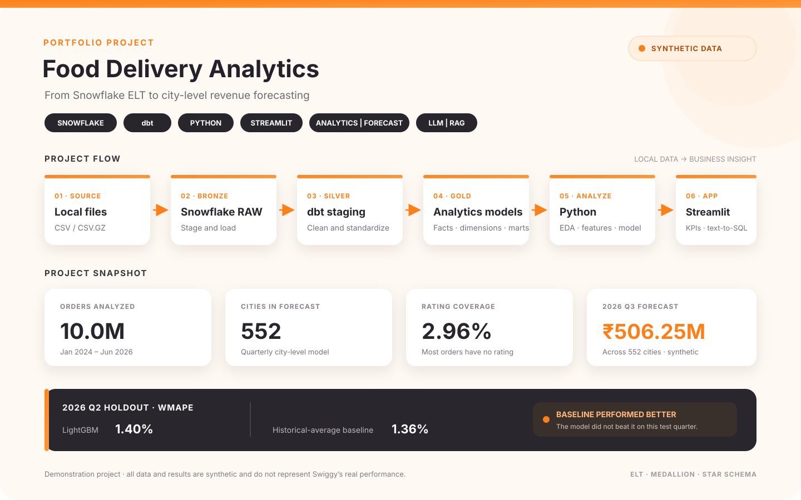

<div align="center">



**Snowflake · dbt · Python · Streamlit · City Revenue Forecasting · LLM & RAG CHATBOT**

[Project report](docs/Swiggy_Analytics_Project_Report.pdf) · [Analysis notebook](swiggy_dbt/analyses/notebook/swiggy_analysis.ipynb)

</div>

> All data and results are synthetic and for demonstration only; they do not represent Swiggy's real performance.

## Project

Built a Snowflake and dbt ELT workflow that transforms food-delivery data into tested analytics models.
Analyzed 10M synthetic orders with Python, including EDA, time-series exploration, and city-level feature engineering.
Trained a quarterly city-revenue forecasting model and compared it with a historical-average baseline.
Created a Streamlit dashboard with KPIs, forecasts, and LLM-assisted text-to-SQL exploration.

## Data model

| Layer | Models | Use |
|---|---|---|
| Raw | Source tables | Loaded CSV data |
| Staging | `stg_*` | Cleaned and standardized data |
| Gold | `DIM_*`, `FACT_*`, `MART_*` | Analysis and dashboard metrics |

**Holdout result:** 2026 Q2 WMAPE was **1.36%** for the historical-average baseline and **1.40%** for LightGBM. The model did not beat the baseline on this test. The displayed 2026 Q3 forecast is **INR 506.25M across 552 cities** (synthetic).

## Run

Requires Python 3.11, Snowflake access, and source data files.

```powershell
git clone https://github.com/biswajeet-gitcom/swiggy-food-project.git
cd swiggy-food-project
py -3.11 -m venv .venv
.\.venv\Scripts\Activate.ps1
pip install dbt-core==1.12.5 dbt-snowflake==1.12.1 snowflake-snowpark-python snowflake-connector-python pandas numpy matplotlib seaborn scikit-learn lightgbm joblib streamlit plotly openai python-dotenv jupyter
```

1. Configure Snowflake credentials in `%USERPROFILE%\\.dbt\\profiles.yml`; add Snowflake settings and `GROQ_API_KEY` to local `.env` files.
2. Load the CSV files into the Snowflake `RAW` tables, then run `cd swiggy_dbt; dbt build`.
3. From the project root, run `streamlit run swiggy_dbt/ai/app.py`.

The app requires an active Snowflake connection; its Ask Your Data feature uses text-to-SQL and requires an LLM API key.


> Before run this project, please check the official `docs` of snowflake and dbt to learn the concept

> For Streamlit Dashboard demo, check the project report (due to limitation of snowflake account subscription and API_KEY usage the app was not deployed)